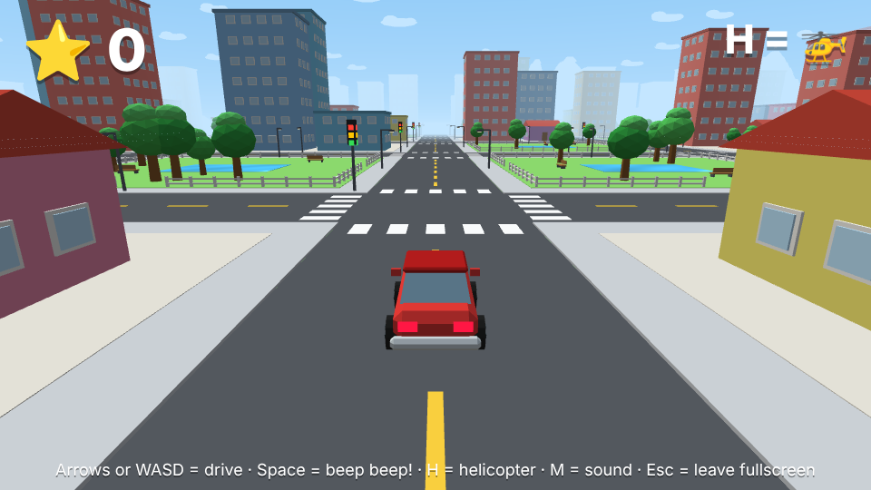
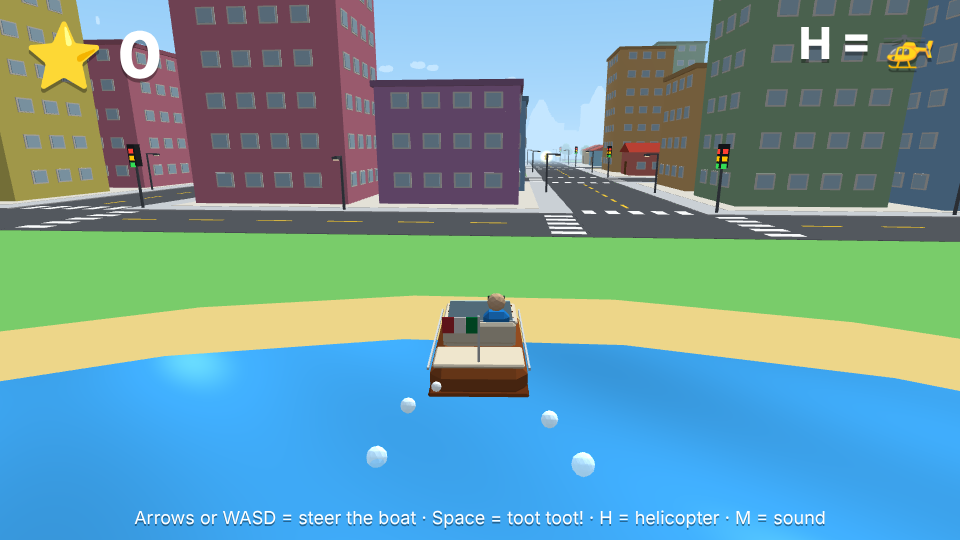
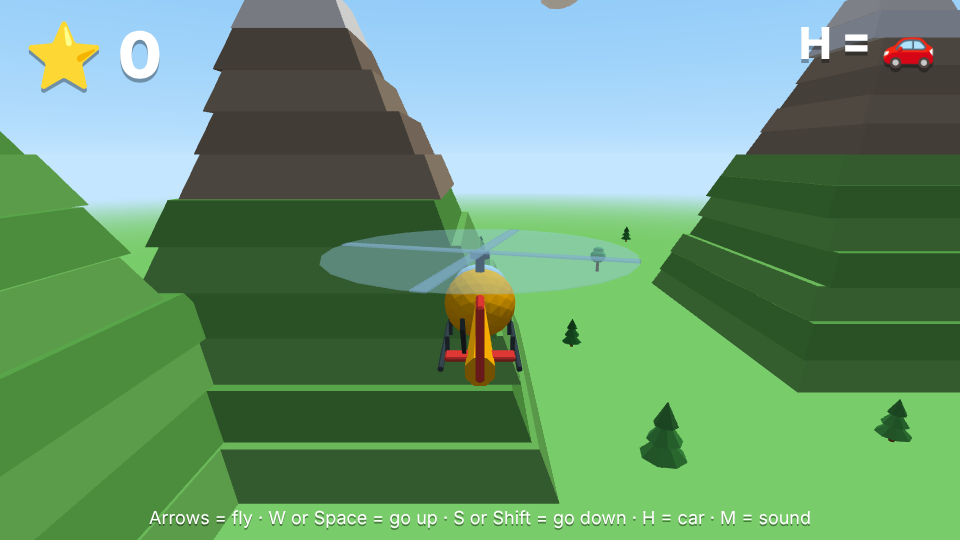
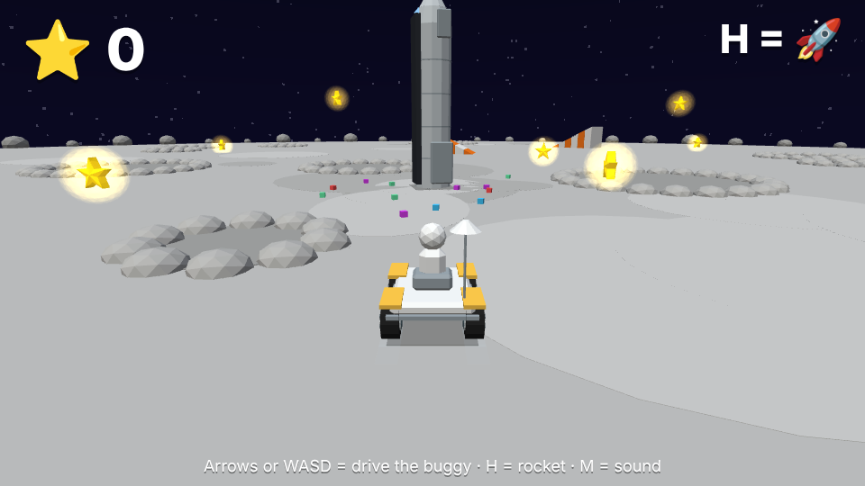

# Vroom City

A simple blocky 3D driving game for small kids. Drive a car around a little town, sail a speedboat on the lake, fly a helicopter over the mountains, blast off in a rocket to the Moon, fly a private jet to a little Tuscan town, and collect stars.

### [▶ Play now](https://vroom-city.vercel.app)

| | |
| --- | --- |
|  |  |
|  |  |

## What it is

- Made for small kids: bright colours, happy sounds and simple controls.
- No crashing and no game over. Just drive around and catch the stars.
- A single HTML file using plain WebGL. No build step, no dependencies, and it works offline.
- Plays in a desktop browser with a keyboard. Chrome works best.

## Controls

| Key | Car | Boat | Helicopter | Jet |
| --- | --- | --- | --- | --- |
| Arrow keys | Drive | Steer | Fly forward/back, turn | ← → steer, ↑ take off / go up, ↓ go down |
| WASD | Drive | Steer | A/D turn, W up, S down | A/D steer, W take off / go up, S go down |
| Space | Horn | Toot toot | Go up | Take off / go up |
| Shift | — | — | Go down | Go down |
| H or Enter | Switch to helicopter (next to the jet: board the jet) | Switch to helicopter | Land (as the boat over water, else the car) | On the runway: back to the car. In the air: land by itself |
| M | Sound on/off | Sound on/off | Sound on/off | Sound on/off |

The car turns into the boat when it drives into the lake or the river, and back into the car on land.

**Space.** The rocket launch station stands just outside town. Drive onto the launch pad (or land the helicopter on its H pad) and press H to board the rocket.

| Key | Rocket near the Earth or the Moon | Rocket in space | Moon buggy |
| --- | --- | --- | --- |
| W, Space or ↑ | Hold to climb | W or Space: go up, ↑: fly forward | ↑ or W: drive |
| S, Shift or ↓ | Go down (lands softly) | S or Shift: go down, ↓: back | ↓ or S: reverse |
| ← → or A D | Turn | Turn | Steer |
| H or Enter | On the launch pad: back to the car | — | Back into the rocket |

Climb for about 15 seconds to reach space. Going down towards the Earth brings the rocket home to the launch pad; going down close to the Moon lands on it, and a buggy rolls out.

**Airport.** A small airfield with a private jet sits in the countryside past the town. Drive up next to the jet and press H to board it. Fly the jet out past the edge of the world to take a trip over the clouds to a little Tuscan town by a lake, and back again the same way.

## Run it locally

```
./play.sh
```

or open `vroom-city.html` in Chrome.

## Checks (development only)

The game needs nothing installed. For the checks, with Node 24: `npm ci`, `npx playwright install chromium`, then `npm run lint` and `npm test`.

The screenshots above and the link preview image are captured from the game with `node scripts/screenshots.mjs`.

## Credits and licence

Made by [emilis3](https://github.com/emilis3).

Licensed under the [PolyForm Noncommercial License 1.0.0](LICENSE): you're free to play it, share it, change it and reuse it for anything that isn't commercial.
